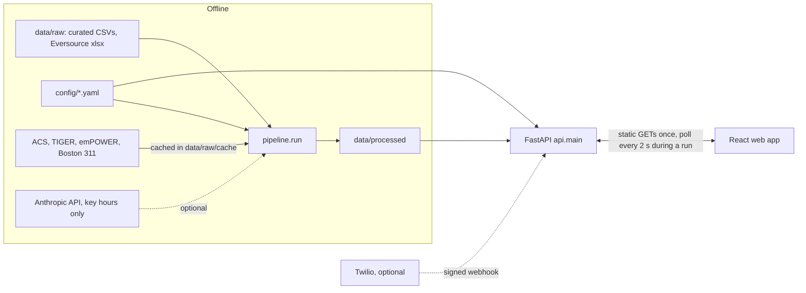
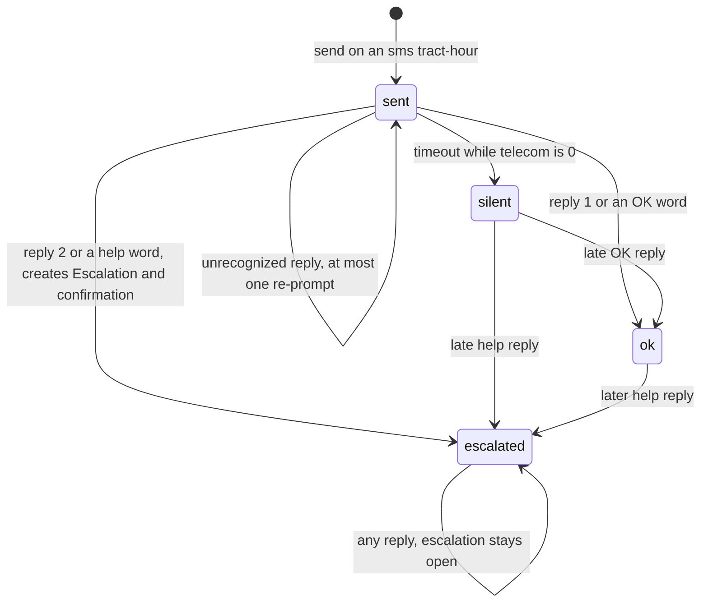

# Design Document: Lifeline City

## Overview

Lifeline City runs as three local processes in one repository:

1. An offline Python 3.13 pipeline (`python -m pipeline.run`) that precomputes every number and every piece of text into `data/processed/`.
2. A FastAPI service that serves those files, reads `config/`, and holds check-in state in memory.
3. A single-page Vite + React + TypeScript app for the Operator, which talks only to the API and polls every 2 seconds while a check-in run is active.

The demo makes no LLM calls and no data calls. The only outbound requests at demo time are basemap tiles (optional; polygons render without them) and Twilio if that optional block is built.

Design goals, in priority order:

1. Every number on screen traces to a config value or a sourced input, and carries its provenance label.
2. The demo is deterministic and offline.
3. The build fits about 5 hours of solo work. Each module is a few pure functions behind a thin I/O wrapper, and the Boston block can be deleted without touching anything else.

### Key decisions

| Decision | Choice | Reason |
|---|---|---|
| `telecom_observed_default_hours` | `12` (ASSUMPTION). Label: "Assumed duration: 12 hours (no end time reported)" | No curated row has `drives_reach_flag = true`, so this value never sets `telecom` in the demo. It must still be a positive integer (Req 6.8). 12 h is longer than the 8 h modeled backup window. The Active_Event definition also uses it to show events with a blank end time in the drawer. |
| Curve shaping | Interpolate each town's ratio to the Cape-wide share between Anchors and hold it constant outside them. Then scale the town-hours that are not pinned so the towns sum to the Cape total. | One helper covers Req 4.4 and 4.7 to 4.9. The curve passes exactly through every Anchor and follows the Tab 3 shape. |
| Timeline layout | Town-hour components, plus tract-hour priority and channel (structure.md) | Tracts inherit town values (Req 7.4). The API expands them per tract-hour. |
| Simulated time | Lazy evaluation. Run state is advanced on every read from `sent_at`, a seeded reply schedule and `now()`. | No background tasks. Deterministic, and testable with an injected clock. |
| LLM scope | Anthropic (`claude-opus-5-5`) only for operator Briefings at the 5 Key_Demo_Hours × 10 queued tracts: at most 50 calls plus at most 50 regenerations. Resident outreach (SMS, doorstep, radio) is hand-written templates in en, pt and es, never LLM. Responses are cached in `data/processed/llm_cache/`, keyed by a hash of model, prompt and metrics (Req 11.13). | Bounded cost. The model takes no `temperature`, so re-runs are deterministic only through the cache (Req 1.4). |
| LLM gating | The LLM step runs only after the key-hour channel report, and only when at least one Key_Demo_Hour queue has both `sms` and `door_knock` tracts. Otherwise the step is skipped with "adjust key_demo_hours". | The demo needs one hour that shows both channels (Req 11.16 to 11.19). |
| Help line | `help_line` per region in `languages.yaml`. Cape: "911 for emergencies, 2-1-1 for shelters and help" (statewide Mass 211; MEMA sent residents there during the storm). Boston: "911 for emergencies, 311 for city help". Every resident template ends with the region's Help_Line_Sentence. | One config value drives the templates and the lint check (Req 13.4, 13.8). |
| Operator household | `demo.operator_household = 1`. In Barnstable and Yarmouth tracts, household #1 is always `pt`. | The presenter replies from household #1, so the Barnstable and Yarmouth demos show a Portuguese thread (Req 17.5). |
| Percentile rank | `average_rank / n_non_null`, in (0, 1]. NaN stays NaN. | Equivalent to pandas `rank(method="average", pct=True)`. Ties share a value. |
| Time format | `YYYY-MM-DDTHH:MM` local (ISO 8601 local time). Each file carries `"tz": "America/New_York"`. | Matches the `key_demo_hours` keys. The window has no DST change. |
| Export | Write directly to `data/processed/` (no staging), then run the privacy guard over `data/processed/` and `api/`. Exit non-zero on any finding. | Simpler than staging (Req 1.10 to 1.12). A flagged run leaves its files in place until the next clean run overwrites them, and the non-zero exit makes the failure visible. |

## Architecture



### Pipeline step order (`pipeline/run.py`)

Steps share one in-memory `Ctx` dataclass. `export` writes every processed output directly to `data/processed/`. The one other writer there is `llm_briefings`, which saves each Anthropic response to `data/processed/llm_cache/` as it arrives, so a crash later in the run does not lose paid calls. Only `fetch` writes to `data/raw/cache/`. Nothing writes anywhere else under `data/raw/`, and the Eversource_Workbook is opened read-only (Req 1.2, 1.9).

| # | Module | Inputs | Produces | Reqs |
|---|---|---|---|---|
| 1 | `fetch` | network or cache | ACS tract and county-subdivision tables, TIGER tracts and cousub, emPOWER ZIP layer 1 | 1.3, 1.7 |
| 2 | `tracts_towns` | TIGER | Cape_Tracts (pop > 0), Cape_Town_Boundaries, tract→town | 3.4, 3.5 |
| 3 | `need` | ACS, emPOWER, tracts | 6 indicators, ranks, `need_t`, missing lists | 2 |
| 4 | `outage_curves` | Tab 3, `cape_total_outage_timeline.csv`, anchors, ACS housing units | customers `N_T`, Cape_Total_Curve, `out_pct[T,h]`, pinned and lower-bound masks | 3.1 to 3.3, 4 |
| 5 | `wires` | Tab 5, `N_T` | `wires_raw[T,h]`, `wires[T,h]`, unmatched-town report | 5 |
| 6 | `telecom` | `cape_telecom_events.csv`, `out_pct` | `telecom[T,h]`, rule, event pins | 6 |
| 7 | `lifelines` | all above | `hours_dark`, contributions, `lifelines`, `priority`, `channel`, queue, Why_Chips | 7, 9.3, 12.1, 12.2 |
| 8 | `synthetic` | queue, tract polygons, `languages.yaml`, `responders.yaml` | households, responders | 17 |
| 9 | `content` (templates) | metrics, Resident_Templates, `languages.yaml` | rendered SMS, doorstep and radio texts; a Template_Briefing for every tract-hour | 11.1, 11.3, 11.8, 12.3, 13 to 16 |
| 10 | `lifelines.key_hour_report` | queue, channels, `key_demo_hours` | per Key_Demo_Hour: sms and door_knock counts with their towns; `has_mixed_hour` | 11.16, 11.17, 11.19 |
| 11 | `content.llm_briefings` | key-hour queues, metrics, `llm_cache/`, optional Anthropic client | Verified_Briefings that replace templates at key-hour queued tracts | 11.2, 11.4 to 11.7, 11.11 to 11.15, 11.18 |
| 12 | `verifier` | Content_Cache, Why_Chips | `verifier_log.json`; stops the run on any template or Why_Chip failure | 11.9, 13.8, 13.9, 27 |
| 13 | `voice_boston` (cuttable) | Boston fetches, `channels.yaml`, `storm_types.yaml` | Boston Need + Voice | 23 |
| 14 | `scale_catalog` | `hazards.yaml`, whether the Voice output exists | catalog entries | 24 |
| 15 | `export` | `Ctx` | `data/processed/*` and `sources.json`, written in place | 1.1, 1.4 to 1.6, 1.10 |
| 16 | `privacy_guard` | `data/processed/`, `api/` | exit 0, or report `path:line: kind` and exit 1 | 1.11, 1.12, 31.4, 31.5 |

CLI: `python -m pipeline.run [--no-llm] [--skip-boston]`. `--skip-boston` is implied when `voice_boston` is not built. With `--no-llm`, step 11 makes no API calls and uses only cache hits (Req 11.15). Step 10 always runs and prints its report, for example:

```text
Key-hour channels
  2026-02-23T09:00  sms 10 (Barnstable, Falmouth, ...)  door_knock 0
  2026-02-24T09:00  sms 4 (Barnstable, Yarmouth)        door_knock 6 (Chatham, Orleans, ...)
  ok: at least one key hour shows both channels
```

The report is also written to `verifier_log.json` under `key_hour_channels`. The builder workflow is: run `--no-llm` first, read the report, adjust `key_demo_hours`, then run with the LLM. The initial 2026-02-23T14:00 entry was too early for any town to meet the 8-hour modeled rule, so checkpoint 8 replaced it with 2026-02-23T17:00. If no key hour shows both channels, step 11 is skipped. Every tract-hour then keeps its Template_Briefing, and the run prints "No key_demo_hours queue has both sms and door_knock tracts: adjust key_demo_hours in config/scoring.yaml." and continues to export with exit 0.

## Components and Interfaces

Interfaces are Python for the pipeline and API and TypeScript for the web app. Bodies are short pseudocode.

### pipeline/common.py (shared helpers, structure.md)

```python
TZ = ZoneInfo("America/New_York")
HOURS: list[str]                      # 119 keys "2026-02-23T01:00" .. "2026-02-27T23:00"
def hour_key(ts: datetime) -> str      # floor to the hour, local time
def hour_end(key: str) -> datetime
def pct_rank(s: pd.Series) -> pd.Series            # average rank / n_non_null; NaN preserved
def normalize(text: str) -> str                     # trim, casefold, NFKD with combining marks removed
def strip_accents(text: str) -> str
def match_town(part: str) -> str | None             # normalize(part) == normalize(T) for one of the 15; never substring
def segments(text: str) -> SegmentCount             # (encoding, units, segments)
def load_scoring(path=CONFIG/"scoring.yaml") -> Scoring  # pydantic; ConfigError on bad weights or default hours
def load_languages(path=CONFIG/"languages.yaml") -> Languages
    # pydantic; ConfigError unless help_line has cape and boston, each with number and en/pt/es sentences,
    # and every language mix sums to 1
def write_json(path: Path, obj) -> None             # sort_keys, floats rounded to 6 dp, coordinates to 6 dp
PROVENANCE = {
  "reconstructed": "Reconstructed from MEMA, Eversource and public-safety reports.",
  "modeled_telecom": "Modeled: assumes tower backup lasts about 8 hours",
  "acs_customers": "Estimated from ACS housing units.",
  "observed_default": "Assumed duration: 12 hours (no end time reported)",
}
CAPE_TOWNS = ("Barnstable", "Bourne", "Brewster", "Chatham", "Dennis", "Eastham", "Falmouth", "Harwich",
              "Mashpee", "Orleans", "Provincetown", "Sandwich", "Truro", "Wellfleet", "Yarmouth")
```

Segment counter (Req 14.2):

```python
GSM7_BASIC = set("@£$¥èéùìòÇ\nØø\rÅåΔ_ΦΓΛΩΠΨΣΘΞÆæßÉ !\"#¤%&'()*+,-./0123456789:;<=>?"
                 "¡ABCDEFGHIJKLMNOPQRSTUVWXYZÄÖÑܧ¿abcdefghijklmnopqrstuvwxyzäöñüà")
GSM7_EXT = set("^{}\\[~]|€\f")                      # 2 septets each
def segments(text):
    if all(c in GSM7_BASIC or c in GSM7_EXT for c in text):
        enc, units, single, multi = "gsm7", sum(2 if c in GSM7_EXT else 1 for c in text), 160, 153
    else:
        enc, units, single, multi = "ucs2", len(text.encode("utf-16-le")) // 2, 70, 67
    return SegmentCount(enc, units, 1 if units <= single else ceil(units / multi))
```

`load_scoring` raises `ConfigError("lifelines_weights must sum to 1, got {...}")` when `abs(sum - 1) > 1e-9` or any weight is negative (Req 7.6). It also checks that `telecom_observed_default_hours` is a positive int (Req 6.8).

### pipeline/fetch.py

```python
def cached_get(name: str, url: str, params: dict | None = None, ext="json") -> bytes
    # data/raw/cache/<name>.<ext>; if present, return it with no network call (Req 1.3)
def acs(tables: list[str], geo: str, vintages=(2025, 2024)) -> tuple[pd.DataFrame, int]
    # first vintage that responds, falling back one year (Req 1.7); the vintage used goes to sources.json
def tiger(kind: Literal["tract", "cousub"]) -> gpd.GeoDataFrame   # tl_2020_25_tract.zip, tl_2020_25_cousub.zip
def empower_zips(bbox_4326) -> gpd.GeoDataFrame
    # FeatureServer layer 1, envelope query, paged by resultOffset,
    # outFields=Zip_Code,COUNTY,Power_Dependent_Devices_DME,Medicare_Benes, returnGeometry=true, f=geojson
def boston_311() -> tuple[pd.DataFrame, pd.DataFrame]                # legacy 2026 + NEW SYSTEM (Boston block only)
```

`CENSUS_API_KEY` comes from `.env` and is optional. A fetch that fails with no cache raises `PipelineError(source, url)` before anything is written.

### pipeline/tracts_towns.py

```python
def cape_towns(cousub) -> gpd.GeoDataFrame
    # COUNTYFP == "001"; name = NAME with a trailing " Town" removed (e.g. "Barnstable Town")
    # PipelineError unless the names match CAPE_TOWNS exactly (all 15, no extras)
def cape_tracts(tracts, pop) -> gpd.GeoDataFrame   # STATEFP 25, COUNTYFP 001, population > 0
def assign_towns(tracts, towns) -> pd.DataFrame    # centroid in EPSG:26986 within a boundary -> "centroid";
                                                   # otherwise the nearest boundary -> "nearest" (Req 3.4, 3.5)
```

### pipeline/need.py (reused by the Boston block for Boston Need)

```python
INDICATORS = ("seniors_alone", "disability", "limited_english", "no_vehicle", "renter", "elec_dependent")
def indicator_values(acs: pd.DataFrame, elec_per_1000: pd.Series) -> pd.DataFrame   # raw values, NaN if missing
def allocate_zip_counts(zips, tracts) -> pd.DataFrame
    # W[z,t] = area(z ∩ t) / area(z) in EPSG:26986; allocated_t = Σ_z count_z · W[z,t]
    # for Power_Dependent_Devices_DME and Medicare_Benes; masked_z = (count_z == 11), value kept as 11 (Req 2.6)
def need_scores(raw: pd.DataFrame) -> pd.DataFrame
    # pct_<k> = pct_rank(raw[k]) within the region passed in; need_t = mean of non-null pct_*;
    # need_missing = [k for k where raw[k] is NaN]                                   (Req 2.2 to 2.4)
```

ACS sources (variable IDs are pinned in `need.py` and checked against the vintage's `variables.json` at fetch time; a missing variable fails loudly):

| Indicator | Table (5-year) | Raw value |
|---|---|---|
| seniors_alone | B11010 (householder living alone, 65+) / B11001 total households | share |
| disability | S1810 percent with a disability | share |
| limited_english | C16002 limited-English households / total | share |
| no_vehicle | B25044 owner + renter no-vehicle / total | share |
| renter | B25003 renter-occupied / total occupied | share |
| elec_dependent | emPOWER DME count allocated / B01003 population × 1,000 | per 1,000 |

ACS sentinel negatives become NaN, and a zero denominator becomes NaN. Town housing units for the customer fallback come from B25001 at the county-subdivision level.

### pipeline/outage_curves.py

```python
def tab3_curve(wb) -> pd.Series
    # ws = wb["Tab 3"] (openpyxl read_only=True, data_only=True); header row 4, data from row 5
    # hour = Date + label ("12AM"->0 .. "11AM"->11, "12PM"->12 .. "11PM"->23)
    # curve = cumsum(Customers Outages - Customers Restored) over all Tab 3 rows (Req 4.2)
    # if curve.max() != 269_063 or curve.idxmax() != "2026-02-23T08:00": raise PipelineError(max, hour)  (Req 4.3)
    # on HOURS: before the first Tab 3 hour -> 0; after the last -> hold the last value

def load_anchors(csv, N) -> list[Anchor]
    # keep county == Barnstable and town in CAPE_TOWNS (drops Plymouth, Scituate, Nantucket, Oak Bluffs, Edgartown)
    # pct = pct_out/100 if present (4.14), else customers_out / N[T] (4.13); clip to [0, 1]
    # drop the excluded sitrep #009 figure (4.15) and record the exclusion without its value

def town_customers(anchors_raw, acs_housing) -> dict[str, Customers]
    # prefer the 2026-02-23T12:30 "MEMA via Patch" row with both fields: customers_out / (pct_out/100)  (3.2)
    # else the first anchor with both fields (source recorded); else ACS housing units with label acs_customers (3.3)

def ratio_shape(base: pd.Series, knots: list[tuple[str, float]]) -> pd.Series
    # rho_i = v_i / base(h_i); rho(h) piecewise-linear between consecutive knots, constant before the first
    # and after the last; result = base(h) * rho(h). In a segment where base(h_i) == 0, interpolate v linearly.

def cape_total(tab3, rows) -> pd.Series   # ratio_shape(tab3, scope == "cape_eversource" rows) (Req 4.4)

def unscaled(town, anchors, share) -> pd.Series
    # knots = all of the town's anchors (same hour: exact beats lower-bound, then latest timestamp)
    # no knots (Chatham): share = cape_total / ΣN; record "no anchors" in sources.json  (4.10)
    # else clip(ratio_shape(share, knots), 0, 1); one knot gives a·C(h)/C(h_a)       (4.7 to 4.9)

def scale_hour(h, u, N, pinned, lb, C) -> tuple[dict[str, float], float]
    # pinned[T] = exact anchor pct whose timestamp falls in hour h (latest wins)       (4.5)
    # R = C[h] - Σ_pinned pinned[T]·N[T]; free towns y=u·N, lo=lb·N, hi=N
    # g(s) = Σ_free clip(s·y, lo, hi) is monotone in s
    # if g(0) <= R <= g(∞): s = bisect(g, R, 60 iterations)                            (4.11)
    # else: s = 0 if R < g(0) else max(hi/y); unmatched = R - g(s), recorded with h    (4.12)
    # out_pct[T,h] = clip(s·y, lo, hi)/N for free towns; pinned values unchanged
```

Every `out_pct` and `hours_dark` series carries `PROVENANCE["reconstructed"]` (Req 4.16).

### pipeline/wires.py

```python
def tab5_calls(wb) -> pd.DataFrame        # rows 5.., C town, D priority, E received, H repaired; G not read
def aggregate(calls, N) -> WiresResult
    # T = match_town(C); unmatched names -> Counter reported in sources.json, run continues  (5.2, 5.3)
    # calls with a blank received time are excluded and counted
    # counts[T, hour_key(E)] += 1                                                         (5.1, 5.4)
    # wires_raw[T,h] = #calls in T with received < hour_end(h) · 1000 / N[T]               (5.5)
    # wires[:,h] = pct_rank(wires_raw[:,h]) across the 15 towns                           (5.6)
```

The output is town-hour arrays only, with no call rows and no street text (Req 5.7). The expected Cape call count (about 1,082) is logged for a sanity check.

### pipeline/telecom.py

```python
def modeled(out_pct_T: np.ndarray, thr=0.8, k=8) -> np.ndarray[bool]
    # m[i] = i >= k-1 and all(out_pct_T[i-k+1 : i+1] >= thr); only hours inside the window  (6.2)
def parse_events(csv, default_hours) -> list[TelecomEvent]
    # parts = [p.strip() for p in town_or_area.split(";")]; matched = [match_town(p) for p in parts if match]  (6.5, 6.6)
    # end = end_local, or start_local + default_hours with end_assumed = True                   (6.7)
def is_active(ev, h) -> bool   # ev.start < hour_end(h) and ev.end > hour_start(h)
def telecom_matrix(out_pct, events) -> tuple[np.ndarray, np.ndarray[str], list[list[str]]]
    # observed[T,h] = any(ev.drives_reach_flag and T in ev.matched and is_active(ev, h))      (6.1)
    # telecom = observed | modeled; rule = none | observed | modeled | both; active event ids (6.3, 6.4)
```

Pins: an event with at least one matched town gets one pin per matched town at that town's label point. An event whose parts match no town (for example "Cape-wide", "Outer Cape", "Barnstable County MACC") gets a pin at the labeled Cape-wide marker, captioned with the raw area text (Req 8.4).

### pipeline/lifelines.py

```python
def hours_dark(out_T, thr, cap) -> np.ndarray
    # first = first index with out_T >= thr (none -> all 0); hd[i] = min(i - first, cap) if out_T[i] >= thr else 0
def lifelines(out, hd, wires, tel, w, cap) -> tuple[np.ndarray, dict[str, np.ndarray]]
    # contrib = {out_pct: w.out·out, hours_dark: w.hd·min(hd/cap, 1), wires: w.wires·wires, telecom: w.tel·tel}
    # lifelines = Σ contrib
def priority(need_t: pd.Series, town_of: pd.Series, lifelines_T) -> np.ndarray   # need_t · lifelines[town(t), h]
def channel(tel_T) -> np.ndarray[str]          # "door_knock" if tel == 1 else "sms"           (12.1, 12.2)
def build_queue(priority_h, need_t, geoids, n) -> list[QueueRow]
    # sorted by (-priority, -need_t, geoid)[:n], rank 1..n                                     (7.7)
def why_chips(metrics) -> list[Chip]           # exactly 2, each {text, field, value} from the flat metrics  (9.3)
    # chip 1: need indicator with the highest pct ("Seniors living alone, 92nd percentile", field need.seniors_alone.pct)
    # chip 2: largest lifelines contribution ("Dark 40 hours" hours_dark | "82% without power" out_pct |
    #         "Downed wires, 85th percentile" wires | "Phones likely degraded (Modeled)" telecom)
def flat_metrics(geoid, h) -> dict[str, float]
    # need_t, need.<k>.raw, need.<k>.pct (non-null only), out_pct, hours_dark, wires, wires_raw, telecom,
    # contrib.<c>, weight.<c>, lifelines, priority, rank (if queued), customers, population
def key_hour_report(queue, channel, key_demo_hours) -> KeyHourReport
    # per h: {sms: {count, towns}, door_knock: {count, towns}}; towns sorted, unique          (11.16)
    # has_mixed_hour = any(h has sms.count > 0 and door_knock.count > 0)                      (11.17, 11.19)
    # a key hour outside the Demo_Window raises ConfigError
```

### pipeline/synthetic.py

```python
PT_FIRST_TOWNS = ("Barnstable", "Yarmouth")
def households(queued_geoids, tracts, langs, n, seed) -> list[Household]
    # rng = np.random.default_rng([seed, int(geoid)]); rejection-sample points in the polygon (EPSG:26986),
    # transform to 4326, round to 4 dp, re-check containment
    # lang = rng.choice from langs.by_town[town], else langs.default; drawn for all n households   (17.3, 17.4)
    # then, if town in PT_FIRST_TOWNS: household #1 lang = "pt" (set after drawing, so the rng
    #   sequence and the other households are unchanged)                                        (17.5)
    # label "Simulated household #i" (i = 1..n per tract); synthetic: True; no address field   (17.1, 17.2, 17.6, 17.8)
def responders(cfg_responders) -> list[Responder]
    # one per (town, role) listed in responders.yaml; label f"{town} {role_label} (Simulated)"; synthetic: True  (17.7, 17.8)
```

Household #1 is also `demo.operator_household`, the household the presenter replies from in the Phone_Simulator, and it never gets a generated reply. In Barnstable and Yarmouth tracts it is therefore always the Portuguese household, so the presenter can show a reply such as "AJUDA" and the Portuguese confirmation. In other towns household #1 keeps its sampled language.

### pipeline/content.py

Resident outreach comes only from hand-written Resident_Templates. The LLM is used only for operator Briefings.

```python
TEMPLATE_KINDS = ("sms_checkin", "sms_confirm", "sms_reprompt", "doorstep", "radio")
TEMPLATES: dict[Lang, dict[TemplateKind, str]]     # hand-written, native per language; pt/es SMS bodies unaccented
REGION = "cape"                                    # every resident render in the demo is a Cape message

def help_sentence(region, lang, langs, form: Literal["sms", "full"]) -> str   # langs.help_line[region].sentence[lang][form]
def render_sms(kind, town, lang, langs) -> SmsText
    # co_line[lang].sms + body + help_sentence(REGION, lang, "sms"); pt/es: strip_accents(); segments() recorded
def render_doorstep(town, lang, langs) -> str      # co_line[lang].full + "Are you OK? Do you need help?" + help sentence (full)
def render_radio(town, h, town_metrics, lang, langs) -> RadioText
    # one fixed template per language; fills {town}, {out_pct_pct} = round(100·out_pct), {next_update_spoken}
def render_all(ctx, langs) -> Outreach
    # SMS kinds and doorstep: every (kind, lang, town) for the 15 towns
    # radio: every (h, town) with a queued tract, 3 languages                              (12.3, 16.1)
    # each render goes through verifier.lint_outreach; any failure raises
    #   PipelineError(kind, lang, town[, hour]) (13.9), or names the Banned_Term (27.3)
    # an SMS render over 2 segments raises PipelineError(kind, lang, town)                  (14.4)
def template_briefing(metrics, channel) -> Briefing  # headline + 2 to 4 claims built from metric values exactly
def action_for(channel) -> str
    # "Send SMS check-ins. Air the AM radio script." | "Send door-knock list to responders. Air the AM radio script."  (11.8)
def build_templates(ctx, langs) -> ContentCache      # step 9: render_all + template_briefing for every tract-hour (11.3)
```

Template checks run for all 15 towns, so a long town name (Provincetown) that would push a pt or es SMS past 2 segments fails the run before export. pt and es SMS bodies are written without accents, so they stay GSM-7 (for example "fogareiro", "tontura ou mal-estar"). Doorstep and radio texts keep their accents.

### pipeline/content.py: LLM briefings (step 11)

```python
MODEL = "claude-opus-5-5"
BRIEFING_SCHEMA = {
  "type": "object", "additionalProperties": False, "required": ["headline", "claims"],
  "properties": {
    "headline": {"type": "string"},
    "claims": {"type": "array", "minItems": 2, "maxItems": 4, "items": {
      "type": "object", "additionalProperties": False, "required": ["text", "field", "value"],
      "properties": {"text": {"type": "string"}, "field": {"type": "string"}, "value": {"type": "number"}}}}}}

def cache_key(model, system, prompt, metrics) -> str     # sha256 of canonical JSON of all four
def request_briefing(client, system, prompt, metrics) -> dict | None
    # hit = data/processed/llm_cache/<key>.json -> apply the checks below to it, no call         (11.13)
    # client is None (--no-llm or no key) -> None                                              (11.7, 11.15)
    # every completed response is cached, including refusal and max_tokens, so a re-run repeats
    #   the same outcome; exceptions are not cached
    # resp = client.messages.create(model=MODEL, max_tokens=4000, system=system,
    #          messages=[{"role": "user", "content": prompt}],
    #          output_config={"effort": "low", "format": {"type": "json_schema", "schema": BRIEFING_SCHEMA}})
    #        # no temperature parameter (the model rejects it)                                 (11.11)
    # any exception, stop_reason in {"refusal", "max_tokens"}, or a body that fails the schema -> None (11.12)
    # else return body (written to the cache as {model, stop_reason, body})
def llm_briefing(metrics, town, channel, client) -> Briefing
    # attempt 1: request; verify_briefing -> [] gives verifier "pass"
    # attempt 2 (prompt adds the rejection reasons): [] gives "regenerated"                     (11.5)
    # otherwise template_briefing(metrics, channel) with verifier "fallback"                    (11.6, 11.7, 11.12)
def llm_briefings(ctx, client, report) -> None
    # if not report.has_mixed_hour: skip and print the "adjust key_demo_hours" message          (11.19)
    # for h in key_demo_hours, g in queue[h]: content.briefings[h][g] = llm_briefing(...)       (11.2, 11.14, 11.18)
```

The client is `anthropic.Anthropic()` with `ANTHROPIC_API_KEY` from `.env`. When the key is missing, the client is `None` and the step behaves like `--no-llm`. The prompt contains only the flat metrics of that tract-hour, the town name and the channel (Req 11.2). The recommended action is always set by `action_for`, never by the LLM. The exact `output_config` shape is checked against the `anthropic` SDK version pinned in `requirements.txt` at build time. Because the model takes no `temperature`, the cache is what makes re-runs reproducible (Req 1.4). The cache key covers the metrics, so a change in metrics forces a new call.

English templates (pt and es are written natively, not word for word):

```text
CO line (sms and full):  Never run a generator, grill or stove indoors or in a garage. If you feel dizzy or have a headache, get fresh air and call 911.
Help line (Cape):        Call 911 for emergencies, 2-1-1 for shelters and help.
Help line (Boston):      Call 911 for emergencies, 311 for city help.          (configured; no Boston resident messages in the demo)

SMS check-in:  {CO} Reply 1 if OK, 2 if you need help. {HELP}
Confirmation:  {CO} Thank you. We are passing your request to a person in {town}. {HELP}
Re-prompt:     {CO} Sorry, we did not understand. Reply 1 if OK, 2 if you need help. {HELP}
Doorstep:      {CO} Are you OK? Do you need help? {HELP}
Radio:         Power is out for about {out_pct_pct} percent of homes in {town}. {CO}
               Please check on neighbors who live alone, especially older neighbors and people who use medical equipment.
               Knock on their door if you can do so safely. {HELP}
               The next update will air at {next_update_spoken}.
```

`{CO}` and `{HELP}` are the `sms` forms in SMS bodies and the `full` forms in doorstep and radio texts. The confirmation repeats 911 through the help sentence (Req 19.5). The radio template is fixed: the same sentences in every render, with only the slot values changing. The English render is about 70 words, roughly 30 seconds read aloud. `next_update_spoken` is the hour plus `demo.radio_update_interval_hours`, written as "10 in the morning" so that no "AM" or "PM" acronym appears.

### pipeline/verifier.py

```python
def verify_claim(c: Claim, m: dict[str, float], tol: Tol) -> list[str]     # [] means accept
    # "missing_field" if c.field not in m; "bad_value" if not finite;
    # "value_mismatch" if |c.value - m[c.field]| > max(tol.abs, tol.rel·|m[c.field]|)        (11.4)
def verify_briefing(b, m, tol, banned) -> list[str]
    # 2 <= len(claims) <= 4, headline non-empty, every claim accepted,
    # every number in headline and claim text is in display_forms(claim values) ∪ {911, 2-1-1, 311}, no banned term
def display_forms(v) -> set[str]    # v, round(v), round(v, 1), round(v, 2), round(100·v)
def lint_outreach(text, kind, lang, region, allowed_numbers, langs) -> list[str]
    # SMS kinds, doorstep: starts with co_line[lang]; radio: sentence 2 starts the CO line     (13.3, 16.2)
    # contains "911" and help_line[region].number ("2-1-1" for the Cape);                     (13.4, 13.8)
    # SMS kinds and doorstep end with help_sentence(region, lang)                               (14.1, 15.4)
    # no "!"; no [A-Z]{2,} token except "OK" (911, 2-1-1 and 311 are digits); no promise pattern (13.6)
    # en: every sentence <= 20 words; radio numbers ⊆ allowed (metric display forms,
    #   911, the help line digits, the next-update hour)                                        (13.7, 16.3)
    # pt/es SMS: ASCII letters only and GSM-7; no banned term                                   (14.5, 27.2)
def run_verifier(content, metrics_index, chips, langs, report) -> VerifierLog
    # every Briefing (LLM and template) through verify_briefing; LLM counts pass | regenerated | fallback  (11.9)
    # a Template_Briefing that fails is a code bug -> PipelineError(hour, geoid, reasons)
    # every resident render through lint_outreach and every Why_Chip through the banned-term check;
    #   any failure -> PipelineError(kind, lang, town[, term])                                  (13.9, 27.3)
    # copies the key-hour report into key_hour_channels                                         (11.16)
```

`render_all` already lints each render as it is built, so step 12 re-checks the final Content_Cache as a whole. Banned-term matching uses whole words after `normalize()`, with an optional plural "s". The term lists live in `languages.yaml`.

### pipeline/voice_boston.py (separate, cuttable block)

```python
def boston_tracts(tracts_suffolk, cousub, pop, cfg) -> gpd.GeoDataFrame
    # centroid inside cousub "Boston" (COUNTYFP 025); pop >= min_tract_pop; drop cfg.boston.exclude_geoids
def boston_need(...)  -> need.need_scores(...) on Boston tracts only                           (23.2)
def requests_311(legacy, new, channels, cfg) -> pd.DataFrame
    # map both schemas to [ts, case_type, channel, lat, lon]; union; keep channel in channels.keep;
    # drop missing coords and points within default_coord.radius_m of (42.3594, -71.0587); sjoin to tracts  (23.3, 23.4, 23.8)
def voice(c, O, pop, d, D, cfg) -> pd.DataFrame
    # r_city_pc = Σc / (Σpop · d); r = (c + k·r_city_pc·pop) / (d + k); S = ΣO / Σ(r·D); lam = r·D·S
    # p = exp(poisson.logcdf(O, lam)); acute = clip(-poisson.logcdf(O, lam)/ln 10, 0, acute_cap); ratio = O/lam
    # rate_pc = c/pop·1000·30/d; structural = pct_rank(-rate_pc)
    # silence = w_a·pct_rank(acute) + w_s·structural; priority = need_t · silence                (23.6, 23.7)
```

Baseline days run from 2026-01-05 to 2026-03-31. They exclude the storm week, the configured ranges (about Jan 24 to 27 and Feb 7 to 9), holidays, and any day whose citywide storm-type count exceeds 3× the median daily count (Req 23.5). D is the storm window length in days.

### pipeline/scale_catalog.py, export.py, privacy_guard.py

```python
def catalog(hazards_cfg, boston_built: bool) -> list[CatalogEntry]
    # 6 entries from hazards.yaml; tier 2 iff place in open_311_towns; scores only on cape_blizzard,
    # and on boston_blizzard when boston_voice exists, otherwise it is a preview entry                (24.1, 24.2, 24.6, 23.12)
def export(ctx) -> None   # write every file directly to data/processed/ with write_json; sources.json last  (1.10)

PHONE = r"(?<![\d.*])(?:\+?1[\s.-]?)?\(?[2-9]\d{2}\)?[\s.-]?\d{3}[\s.-]?\d{4}(?!\d)"
ADDRESS = r"\b\d{1,5}\s+(?:[A-Z][a-z]+\s+){1,3}(?:Street|St|Road|Rd|Avenue|Ave|Lane|Ln|Drive|Dr|Way|Court|Ct|Boulevard|Blvd|Place|Pl|Terrace|Circle|Highway|Hwy)\b"
def scan(roots: list[Path]) -> list[Finding]    # Finding(path, line, kind: "phone_number" | "street_address")
def main(argv) -> int                            # prints "path:line: kind" only, never the match; 1 if any finding
```

After `export`, `run.py` runs `privacy_guard.scan([data/processed/, api/])` over every file, including `llm_cache/` (Req 1.11). On any finding it prints `path:line: kind` lines and exits 1 (Req 1.12). The flagged files stay on disk until a clean run overwrites them. The lookbehind on `.` and `*` keeps masked numbers and decimals out of the matches. Floats are rounded to 6 decimal places and GEOIDs start with "25", so neither forms a 10-digit NANP match.

### API (`api/`)

| Module | Responsibility |
|---|---|
| `data.py` | Pydantic models that mirror each processed file. Loads all files at startup into a read-only `Store` with indexes (tract→town, hour index, households by tract, responders by town). A missing required file stops startup with "run python -m pipeline.run". `boston_voice.geojson` is optional. |
| `state.py` | `CheckInStore` (in memory, guarded by a `threading.Lock`), the run state machine, the seeded reply schedule and `reset()`. The clock is injected. |
| `reach.py` | Channel lookup, door-knock list assembly, access hazard rule. |
| `sms.py` | `normalize`, `classify(body) -> "ok" \| "help" \| None`, `Sender` protocol (`SimulatorSender`, optional `TwilioSender`), `mask_phone`. |
| `main.py` | Routes, CORS limited to `http://localhost:5173` and `http://127.0.0.1:5173`, bound to `127.0.0.1:8000`. |

Endpoints:

| Method | Path | Response | Reqs |
|---|---|---|---|
| GET | `/api/health` | `{ok, boston_voice: bool, sms_mode}` | |
| GET | `/api/hours` | `{tz, hours[119], key_demo_hours}` | 8.2 |
| GET | `/api/towns` | `cape_towns.geojson` | 8.4 |
| GET | `/api/tracts` | `cape_tracts.geojson` | 8.1 |
| GET | `/api/timeline` | `cape_timeline.json` (loaded once by the web app) | 8.3 |
| GET | `/api/queue?hour=` | `QueueRow[]` for the hour | 9.1, 9.2 |
| GET | `/api/tracts/{geoid}?hour=` | `TractDetail` | 10 |
| GET | `/api/content/{geoid}?hour=` | `{briefing, reach: {channel, rule, label, sms?, doorstep, radio}}` in 3 languages, from the Content_Cache only | 11.10, 12.4, 12.7 |
| GET | `/api/telecom-events` | `telecom_events.json` | 8.4, 8.5 |
| GET | `/api/sources` | `sources.json` | 8.8, 25.2 |
| GET | `/api/scale-catalog` | `scale_catalog.json` | 24 |
| GET | `/api/boston/voice` | `boston_voice.geojson`, or 404 when absent | 23.9 |
| POST | `/api/checkins/send` | body `{geoid, hour}` → 201 `Run`; 200 with the existing run for the same tract-hour; 409 `phones_degraded`; 409 `no_households`; 404 | 18.1, 15.6 |
| GET | `/api/checkins/{run_id}` | `Run` after `advance(run, now)` | 18.7, 18.9 |
| POST | `/api/simulator/reply` | body `{run_id, household_id, body}` → `Run` | 18.5, 19 |
| POST | `/api/demo/reset` | `{ok: true}` | 21.1 |
| POST | `/api/sms/twilio` (Optional) | Validates `X-Twilio-Signature` with `TWILIO_AUTH_TOKEN`, then 200 TwiML; on failure 403 with no reply recorded | 22 |

The API has no authentication. It is bound to localhost for demo use only, and the README says so (Req 28.3). If the optional Twilio webhook is exposed through a tunnel, signature validation is its only protection.

#### Check-in state machine (`api/state.py`)



A send on a `door_knock` tract-hour returns 409 and sends no message and creates no run (Req 15.6). Households of a `door_knock` tract-hour are shown with the derived status `awaiting_door_knock` and are never marked silent (Req 20.2).

```python
def send(geoid, hour, now) -> Run
    # channel(geoid, hour) == "door_knock" -> Rejected("phones_degraded")
    # households empty -> Rejected("no_households"); existing (geoid, hour) run -> return it
    # run.telecom = 0; each household: status "sent", outbound check-in in its language via Sender
    # schedule = seeded_schedule(Random(f"{seed}:{geoid}:{hour}")): for every household except the operator
    #   household (#demo.operator_household), draw ok | help | unclear | none from demo.reply_mix and
    #   a delay in demo.reply_delay_s; bodies drawn from "1"/"2" and languages.yaml keywords

def process_reply(run, hh, body, at, generated: bool)
    # log inbound (generated replies are labeled "Simulated"); cls = classify(body)
    # help: if no escalation yet, create Escalation(responder = round-robin over the household town's responders)
    #       and send the confirmation; status = "escalated"                                   (19.4, 19.5)
    # ok:   status = "ok" unless already "escalated"                                          (19.2, 20.4)
    # None: unrecognized += 1; if reprompts == 0, send the re-prompt and set reprompts = 1     (19.6, 19.7)

def advance(run, now)
    # deliver due scheduled replies in order via process_reply(generated=True)
    # if run.telecom == 0: households still "sent" at sent_at + DEMO_REPLY_TIMEOUT_SECONDS become "silent",
    #   with silent_reason "unclear_reply" if they sent only unrecognized replies, else "no_reply"   (20.1)
    # counters = {sent, ok, need_help = #escalated, silent}; status = "complete" when all are ok, escalated or silent
```

`DEMO_REPLY_TIMEOUT_SECONDS` defaults to 30 when unset. At startup the API clamps `reply_delay_s` below the timeout and logs a warning. `reset()` swaps in a fresh `CheckInStore()` (Req 21.1). Because the seeded schedule depends only on `(seed, geoid, hour)`, a rerun after reset replays the same replies.

Sending (Req 18.2, 18.3, 22): `Sender` is `SimulatorSender` unless the Twilio block is built, `SMS_MODE == "twilio"`, and the household is mapped to a number in `DEMO_PHONE_NUMBERS` (comma-separated, assigned to household #1..n in order). A Twilio failure falls back to the simulator and logs `mask_phone(number)` (Req 22.4, 26.4).

### Web (`web/src/`)

```text
+--------------------------------------------------------------------------------------------+
| Lifeline City   [Scale selector v]   Layer: (Priority | Need | Lost lifelines)  [Reset demo] |
+--------------------------------------------------------+-----------------------------------+
| MapView: tracts, town lines, telecom pins              | Queue (top 10 at the hour)        |
|  legend with numeric breaks, SourceBadges              |  1  Falmouth  tract 0101.02  0.61 |
|  Tract list (keyboard picker synced with the map)      |     SMS   [Dark 40 hours] [...]   |
+--------------------------------------------------------+                                   |
| TimeSlider  < Mon 23 Feb, 9:00 >   [key demo hours]    |                                   |
+--------------------------------------------------------+-----------------------------------+
TractDrawer (right overlay, focus moves in, Esc closes): Briefing (Verified | Template), WhyFlagged,
active telecom events, ReachPanel (channel, rule label, language tabs, preview,
Send check-ins | Door-knock list, AM radio script), counters, escalations, follow-up list,
PhoneSimulator (household picker, thread with "Simulated" label and sender outside the body, reply box)
```

```ts
type Lang = "en" | "pt" | "es";
type Layer = "priority" | "need" | "lifelines";
type View = { kind: "cape" } | { kind: "boston" } | { kind: "preview"; entryId: string };
interface AppState {
  view: View; hourIdx: number; layer: Layer; selectedGeoid: string | null;
  reachLang: Lang; runId: string | null; simHouseholdId: string | null;
}
// hooks
useStaticData(): { hours; towns; tracts; timeline; events; catalog; sources } // fetched once
useTractDetail(geoid: string | null, hour: string): TractDetail | undefined
useRunPolling(runId: string | null): Run | undefined   // setInterval 2000 while status === "active"; cleared on complete or unmount
```

| Component | Notes | Reqs |
|---|---|---|
| `MapView` | MapLibre with a GeoJSON source using `promoteId: "geoid"`. On hour or layer change it calls `setFeatureState` for each tract (well under 1 s). Uses the CARTO dark-matter style (no token). On a style error it switches to a blank style with a background layer. Hover tooltip and the keyboard Tract list both show the layer value as text. | 8.1, 8.3, 8.6, 8.7, 29.4 |
| `TimeSlider` | `<input type="range" min=0 max=118>` with `aria-valuetext` set to the local time, plus key-hour buttons | 8.2, 29.1 |
| `Queue` | Rows are `<button>` elements with town, tract, priority number, channel and 2 Why_Chips | 9 |
| `TractDrawer`, `WhyFlagged` | Every component, weight and contribution as numbers. Shows the rule label, the "Modeled" label or citation, and missing indicators. | 10, 25.3, 25.4 |
| `ReachPanel` | Channel and rule, language switcher, SMS preview with "Send check-ins", or the Door_Knock_List, plus the radio script labeled for the county AM station | 12.4 to 12.7, 15 |
| `PhoneSimulator` | Thread per household with a "Simulated" badge. Phone numbers only through `maskPhone`. | 14.8, 18.4, 26.5 |
| `ScaleSelector` | 6 entries. Cape opens the map, Boston opens `BostonVoiceView` (or a preview when the endpoint returns 404), and the others open a Configuration_Preview with no scores. | 24, 23.12 |
| `BostonVoiceView` | Static map with Priority, Need, Acute silence and Structural silence layers, a storm window label, and "Heard 9, expected 41" text in the tooltip and a top-15 table | 23.10, 23.11 |
| `SourceBadges` | Provenance labels for the layers on screen | 8.8 |

Accessibility: every control is a native button, input or select. Focus rings use `focus-visible:outline`. Icon buttons have `aria-label`. Color scales always come with text values (Req 29.1 to 29.4). Synthetic records always render a "Simulated" badge (Req 17.10). `api.ts` reads `import.meta.env.VITE_API_BASE ?? "http://localhost:8000"` (Req 28.4).

### Kiro hooks (`.kiro/hooks/`)

| File | Trigger | Matcher | Command | Reqs |
|---|---|---|---|---|
| `required-pbt.json` | PostFileSave | `/pipeline/.*\.py$` | `.venv/bin/python -m pytest -q -m required_pbt` | 31.2, 31.3 |
| `privacy-guard-save.json` | PostFileSave | `/(api\|data/processed)/` | `.venv/bin/python -m pipeline.privacy_guard api data/processed` | 31.4, 31.5 |
| `privacy-guard-create.json` | PostFileCreate | `/(api\|data/processed)/` | same | 31.4 |
| `privacy-guard-stop.json` | Stop | (ignored) | same | 31.4 |

Files written by the pipeline process do not fire editor save events. Three layers close that gap: (1) `run.py` runs the guard over `data/processed/` and `api/` after export, so pipeline writes are always scanned; (2) the Stop hook re-scans after every agent turn, which covers files the agent wrote through tools; (3) the save and create hooks cover manual edits. pytest prints the failing test name, and Hypothesis prints `Falsifying example: ...` on failure, which meets Req 31.3. The `required_pbt` marker is registered in `pyproject.toml`.

### Docs

- `README.md`: run steps in order (`uv venv --python 3.13`, `python -m pipeline.run`, `uvicorn api.main:app --port 8000`, `cd web && npm run dev`). It states there is no auth and the app is for local demo use only.
- `docs/methods.md`, one page at most (Req 2.8): formulas, ZIP-to-tract area-weight simplification, emPOWER masking (1 to 10 reported as 11), curve reconstruction, assumptions (modeled telecom, 12 h default, Barnstable and Yarmouth language mix, ACS customer fallback), the Cape help line choice (Mass 2-1-1, where MEMA sent residents), and the excluded sitrep figure. Detail beyond one page stays in code comments and this design.
- `docs/kiro-usage.md`: steering files, this spec, and the hooks.

## Data Models

All processed files use `"tz": "America/New_York"` and `YYYY-MM-DDTHH:MM` hour keys. Each file has a pydantic model in `api/data.py` and a matching type in `web/src/types.ts`. Shapes are written in TypeScript notation.

### data/processed

```ts
type HourKey = string; type Geoid = string; type Town = string;
type Indicator = "seniors_alone" | "disability" | "limited_english" | "no_vehicle" | "renter" | "elec_dependent";
type TelecomRule = "none" | "observed" | "modeled" | "both";
type Channel = "sms" | "door_knock";

// cape_tracts.geojson  (FeatureCollection, EPSG:4326)
interface TractProps {
  geoid: Geoid; name: string; town: Town; town_assignment: "centroid" | "nearest"; population: number;
  need_t: number; need: Record<Indicator, { raw: number | null; pct: number | null; unit: "share" | "per_1000" }>;
  need_missing: Indicator[]; empower_masked: boolean; households_n: number;
}
// cape_towns.geojson
interface TownProps {
  name: Town; customers: number; customers_source: string; customers_label: string | null; // acs_customers label for Sandwich, Chatham
  anchor_count: number; label_point: [number, number];
}
// cape_timeline.json  (arrays are indexed like hours[])
interface CapeTimeline {
  tz: string; hours: HourKey[]; weights: Record<"out_pct" | "hours_dark" | "wires" | "telecom", number>;
  hours_dark_cap: number; labels: { reconstructed: string; modeled_telecom: string };
  towns: Record<Town, {
    out_pct: number[]; hours_dark: number[]; wires_raw: number[]; wires: number[];
    telecom: (0 | 1)[]; telecom_rule: TelecomRule[]; telecom_event_ids: string[][];
    contrib: Record<"out_pct" | "hours_dark" | "wires" | "telecom", number[]>;
    lifelines: number[]; pinned: boolean[]; lower_bound: (number | null)[];
  }>;
  tracts: Record<Geoid, { town: Town; priority: number[]; channel: Channel[] }>;
  queue: Record<HourKey, QueueRow[]>;
}
interface QueueRow { rank: number; geoid: Geoid; town: Town; priority: number; need_t: number; channel: Channel; why_chips: Chip[] }
interface Chip { text: string; field: string; value: number }
// telecom_events.json
interface TelecomEvent {
  id: string; system: string; status: string; affects: "residents" | "responders"; start_local: string;
  end_local: string | null; end_assumed: boolean; source_name: string; source_url: string;
  drives_reach_flag: boolean; areas: string[]; matched_towns: Town[];
  pins: { kind: "town" | "cape_wide"; town?: Town; caption: string; lon: number; lat: number }[];
}
// content.json
interface ContentCache {
  tz: string; region: "cape"; help_line: { number: string; sentence: Record<Lang, string> };
  sms: Record<Town, Record<Lang, Record<"checkin" | "confirm" | "reprompt",
    { text: string; encoding: "gsm7" | "ucs2"; units: number; segments: 1 | 2 }>>>;
  doorstep: Record<Town, Record<Lang, string>>;
  radio: Record<HourKey, Record<Town, Record<Lang, { text: string; words: number }>>>;
  briefings: Record<HourKey, Record<Geoid, Briefing>>;
  back_translations?: Record<"pt" | "es", Record<"sms_checkin" | "sms_confirm" | "sms_reprompt" | "doorstep" | "radio",
    { en: string; intent_match: boolean }>>;                           // Optional (13.5)
}
interface Briefing { kind: "verified" | "template"; headline: string; claims: Claim[]; action: string; verifier: "pass" | "regenerated" | "fallback" }
interface Claim { text: string; field: string; value: number }
// verifier_log.json
interface VerifierLog {
  counts: { pass: number; regenerated: number; fallback: number };    // LLM Briefings at Key_Demo_Hours
  template_briefings: { checked: number; pass: number };              // must equal checked, or the run stops
  outreach: Record<"sms" | "doorstep" | "radio" | "why_chip", { checked: number }>;   // any failure stops the run
  failures: { kind: "briefing"; key: string; attempt: 1 | 2; reasons: string[] }[];  // rejected or failed LLM attempts
  llm_step: "ran" | "no_llm" | "no_key" | "skipped_key_hours";
  key_hour_channels: Record<HourKey, { sms: { count: number; towns: Town[] }; door_knock: { count: number; towns: Town[] } }>;
  has_mixed_hour: boolean;
}
// llm_cache/<sha256>.json: { model: string; stop_reason: string; body: { headline: string; claims: Claim[] } | null }
// households.json, responders.json
interface Household { id: string; label: string; geoid: Geoid; town: Town; lang: Lang; lon: number; lat: number; synthetic: true }
interface Responder { id: string; town: Town; role: string; label: string; synthetic: true }
// scale_catalog.json
interface CatalogEntry {
  id: string; place: string; hazard: string; tier: 1 | 2; mode: "live" | "preview";
  lost_lifelines_inputs: string[]; need_inputs: string[]; data_endpoint?: string; // no score fields on previews
}
// sources.json
interface Sources {
  provenance_labels: Record<string, string>;
  inputs: { file: string; row: number; source_name: string; source_url: string; used_in: string[] }[];
  excluded: { file: string; row: number; reason: string }[];          // sitrep #009 figure, non-Barnstable anchors
  tab5_unmatched_towns: { town: string; calls: number }[];
  unmatched_hours: { hour: HourKey; unmatched_customers: number }[];
  towns_without_anchors: Town[]; customer_count_sources: Record<Town, string>;
  assumptions: { key: string; value: string | number; label: string }[];
  fetches: { name: string; url: string; vintage?: number }[];
}
// boston_voice.geojson (Boston block)
interface BostonProps {
  geoid: Geoid; name: string; population: number; need_t: number; need: TractProps["need"]; need_missing: Indicator[];
  observed: number; expected: number; ratio: number; p: number; acute: number; acute_pct: number;
  rate_pc: number; structural: number; silence: number; priority: number; rank: number;
}
// plus a foreign member "metadata": { storm_window, baseline, excluded_days, D, S, k }
```

API-only models (`api/state.py`), all with `synthetic: true` (Req 17.9):

```ts
interface Message { direction: "out" | "in"; kind: "checkin" | "confirm" | "reprompt" | "reply"; body: string; at: string; generated: boolean }
interface HouseholdRun { household_id: string; label: string; lang: Lang; status: "sent" | "ok" | "escalated" | "silent";
  silent_reason: "no_reply" | "unclear_reply" | null; reprompts: 0 | 1; unrecognized: number; messages: Message[]; synthetic: true }
interface Escalation { id: string; run_id: string; household_id: string; label: string; lang: Lang; created_at: string; responder_label: string; synthetic: true }
interface Run { id: string; geoid: Geoid; town: Town; hour: HourKey; telecom: 0; sent_at: string; status: "active" | "complete";
  counters: { sent: number; ok: number; need_help: number; silent: number }; households: HouseholdRun[]; escalations: Escalation[]; synthetic: true }
interface DoorKnockEntry { household_label: string; lang: Lang; why_chips: Chip[]; responder_label: string; doorstep_script: string;
  access_hazard: string | null; synthetic: true }   // "Downed wires reported nearby. Treat every wire as live."
interface TractDetail { geoid: Geoid; town: Town; hour: HourKey; metrics: Record<string, number>; need: TractProps["need"];
  need_missing: Indicator[]; telecom_rule: TelecomRule; telecom_label: string | null; rank: number | null; channel: Channel;
  why_chips: Chip[]; active_events: TelecomEvent[]; run: Run | null; door_knock: DoorKnockEntry[] | null;
  households: { id: string; label: string; lang: Lang; status: HouseholdRun["status"] | "awaiting_door_knock" | "not_contacted" }[] }
```

### config/

```yaml
# scoring.yaml
lifelines_weights: {out_pct: 0.4, hours_dark: 0.3, wires: 0.1, telecom: 0.2}
hours_dark_cap: 72
dark_threshold: 0.5
telecom_model: {out_pct_threshold: 0.8, consecutive_hours: 8}
telecom_observed_default_hours: 12          # ASSUMPTION: "Assumed duration: 12 hours (no end time reported)"
access_hazard_wires_pct: 0.8
queue_size: 10
key_demo_hours: ["2026-02-23T09:00", "2026-02-23T17:00", "2026-02-24T09:00", "2026-02-25T15:00", "2026-02-26T13:00"]
                                             # initial values; adjusted after the first --no-llm key-hour report
verifier: {abs_tol: 0.01, rel_tol: 0.01}
demo:
  seed: 20260223
  households_per_tract: 8
  operator_household: 1                      # household #1 never gets a generated reply; pt in Barnstable and Yarmouth
  reply_mix: {ok: 0.55, help: 0.2, unclear: 0.05, none: 0.2}
  reply_delay_s: [3, 20]
  radio_update_interval_hours: 2
boston:
  k_pseudo_days: 7
  acute_cap: 6
  silence_weights: {acute: 0.5, structural: 0.5}
  min_tract_pop: 500
  exclude_geoids: []                         # Logan, Harbor Islands, large parks: filled during the Boston block
  storm_window: ["2026-02-22T14:00", "2026-02-25T23:59"]
  baseline: ["2026-01-05", "2026-03-31"]
  baseline_exclude: [["2026-01-24", "2026-01-27"], ["2026-02-07", "2026-02-09"], ["2026-02-22", "2026-02-28"]]
  holidays: ["2026-01-19", "2026-02-16"]
  storm_spike_multiplier: 3
  default_coord: {lat: 42.3594, lon: -71.0587, radius_m: 50}

# languages.yaml
supported: [en, pt, es]
labels: {en: English, pt: Português, es: Español}
reply_keywords:
  en: {ok: [OK, YES], help: [HELP]}
  pt: {ok: [OK, SIM], help: [AJUDA]}
  es: {ok: [OK, SI], help: [AYUDA]}
co_line:                                     # sms = unaccented GSM-7 body text; full = accented, for doorstep and radio
  en: {sms: "Never run a generator, grill or stove indoors or in a garage. If you feel dizzy or have a headache, get fresh air and call 911.", full: "<same>"}
  pt: {sms: "<native, unaccented>", full: "<native, accented>"}
  es: {sms: "<native, unaccented>", full: "<native, accented>"}
help_line:                                   # Help_Line_Sentence per region; same sms/full split as co_line
  cape:                                      # statewide Mass 211; MEMA sent residents there during the storm
    number: "2-1-1"
    sentence:
      en: {sms: "Call 911 for emergencies, 2-1-1 for shelters and help.", full: "<same>"}
      pt: {sms: "<native, unaccented>", full: "<native, accented>"}
      es: {sms: "<native, unaccented>", full: "<native, accented>"}
  boston:
    number: "311"
    sentence:
      en: {sms: "Call 911 for emergencies, 311 for city help.", full: "<same>"}
      pt: {sms: "<native, unaccented>", full: "<native, accented>"}
      es: {sms: "<native, unaccented>", full: "<native, accented>"}
allowed_acronyms: ["911", "2-1-1", "311", "OK"]
banned_terms:
  en: [neglected, ignored, abandoned]
  pt: [negligenciado, negligenciada, ignorado, ignorada, abandonado, abandonada]
  es: [descuidado, descuidada, ignorado, ignorada, abandonado, abandonada]
promise_patterns:                            # regexes for promised response times
  en: ["\\bwithin \\d+", "\\bin \\d+ (minutes|hours)"]
  pt: ["\\bem \\d+ (minutos|horas)"]
  es: ["\\ben \\d+ (minutos|horas)"]
household_language_mix:                      # ASSUMPTION, used only for synthetic households
  label: "Assumed language mix for simulated households"
  default: {en: 0.85, pt: 0.10, es: 0.05}    # every town not listed in by_town
  by_town:
    Barnstable: {en: 0.6, pt: 0.3, es: 0.1}  # ASSUMPTION; household #1 of each tract is forced to pt
    Yarmouth:   {en: 0.6, pt: 0.3, es: 0.1}  # ASSUMPTION; household #1 of each tract is forced to pt

# responders.yaml
roles:
  police_wellness: "police wellness check"
  fire_wellness: "fire wellness check"
  coa_driver: "COA driver"
  elder_services: "Elder Services worker"
  meals_on_wheels: "Meals on Wheels driver"
towns:                                       # all 15 Cape towns listed; same default set unless overridden
  Falmouth: [police_wellness, fire_wellness, coa_driver, elder_services, meals_on_wheels]
  # ... Barnstable through Yarmouth

# hazards.yaml
hazards:
  blizzard:  {label: Blizzard, lost_lifelines: [power, phones, blocked roads]}
  noreaster: {label: "Nor'easter", lost_lifelines: [power, phones, blocked roads]}
  ice_storm: {label: Ice storm, lost_lifelines: [power, phones, blocked roads]}
  flood:     {label: Flood, lost_lifelines: [flood zones, river gauges, road closures]}
  heat:      {label: Heat, lost_lifelines: [power, heat index]}
need_inputs: [seniors living alone, disability, limited-English households, no-vehicle households, renter share, electricity-dependent Medicare beneficiaries]
open_311_towns: [Boston]
entries:
  - {id: cape_blizzard, place: "Barnstable County (Cape Cod)", hazard: blizzard, mode: live}
  - {id: boston_blizzard, place: Boston, hazard: blizzard, mode: live_if_built}
  - {id: plymouth_noreaster, place: Plymouth, hazard: noreaster, mode: preview}
  - {id: worcester_ice_storm, place: Worcester, hazard: ice_storm, mode: preview}
  - {id: lowell_flood, place: Lowell, hazard: flood, mode: preview}
  - {id: springfield_heat, place: Springfield, hazard: heat, mode: preview}

# channels.yaml (Boston block): values are confirmed against observed 311 channel values during the block
keep: ["Constituent Call", "Self Service", "Citizens Connect App"]
drop: ["Employee Generated", "City Worker App", "Maximo Integration"]
unknown: drop_and_report

# storm_types.yaml (Boston block): case types counted for storm-spike day exclusion
case_types: ["<snow plowing request>", "<unshoveled sidewalk>", "<downed tree>"]   # confirmed against observed values
```

`.env.example` has empty values for `ANTHROPIC_API_KEY`, `AWS_REGION`, `CENSUS_API_KEY`, `SMS_MODE`, `TWILIO_ACCOUNT_SID`, `TWILIO_AUTH_TOKEN`, `TWILIO_FROM_NUMBER`, `DEMO_PHONE_NUMBERS` and `DEMO_REPLY_TIMEOUT_SECONDS` (Req 26.3). `.gitignore` excludes `.env`, `data/raw/cache/`, `.venv/`, `web/node_modules/` and `web/dist/`.

## Correctness Properties

*A property is a characteristic or behavior that should hold true across all valid executions of a system: a formal statement about what the system should do. Properties are the bridge between human-readable specifications and machine-verifiable correctness guarantees.*

Properties 1 to 4 are the required tests of Requirement 30 (marker `required_pbt`). Properties 5 to 28 are optional and are built only if time remains.

### Property 1: Lifelines and priority stay in [0, 1] (Required)

*For any* out_pct, wires and need_t in [0, 1], any hours_dark ≥ 0, any telecom in {0, 1} and any non-negative `lifelines_weights` that sum to 1, `lifelines` equals the weighted sum with the hours term `min(hours_dark/cap, 1)` and lies in [0, 1], and `priority_Cape = need_t × lifelines` lies in [0, 1].

**Validates: Requirements 7.3, 7.4, 7.5, 30.1**

### Property 2: Channel follows telecom and every queued tract-hour has a radio script (Required)

*For any* generated town-hour telecom matrix, tract-to-town assignment, need values and town-hour metrics, `channel(t,h)` is `sms` exactly when `telecom(town(t),h) = 0` and `door_knock` exactly when it is 1, and for every tract in the Priority_Queue at every Hour the built content holds an AM_Radio_Script for `(h, town(t))` in en, pt and es.

**Validates: Requirements 12.1, 12.2, 12.3, 16.1, 30.2**

### Property 3: Verifier accepts exactly the grounded claims (Required)

*For any* flat metrics dict and any claim, `verify_claim` accepts the claim if and only if its `field` is a key of the metrics and `|value − metrics[field]| ≤ max(abs_tol, rel_tol·|metrics[field]|)`. In particular, every claim with an absent field or a value pushed outside tolerance is rejected, and every claim copied from the metrics is accepted.

**Validates: Requirements 11.4, 30.3**

### Property 4: SMS segment rules and the 2-segment cap (Required)

*For any* generated string, `segments(text)` equals a reference count: GSM-7 when every character is in the GSM 03.38 basic or extension table (extension characters count 2; 160 for one segment, 153 per segment otherwise), and UCS-2 otherwise (UTF-16 units; 70 for one segment, 67 per segment otherwise). And *for every* Cape_Town and Supported_Language, every SMS_Check_In, reply confirmation and re-prompt in the Content_Cache (or rendered from the Resident_Templates when no cache exists) has at most 2 segments.

**Validates: Requirements 14.2, 14.3, 30.4**

### Property 5: Need score is the mean of available ranks

*For any* indicator table with arbitrary missing cells (each row with at least one value), every percentile rank lies in (0, 1], ranks preserve order within an indicator (ties get equal ranks), `need_t` equals the mean of that row's non-missing ranks, and `need_missing` lists exactly the missing indicators.

**Validates: Requirements 2.2, 2.3, 2.4, 23.2**

### Property 6: ZIP allocation conserves counts

*For any* non-negative ZIP-to-tract overlap weight matrix with row sums ≤ 1 and any ZIP counts, the allocated tract counts sum to `Σ_z count_z × rowsum_z`, and each ZIP is flagged masked exactly when its count is 11.

**Validates: Requirements 2.5, 2.6**

### Property 7: Shaped curves pass through their anchors

*For any* positive base curve and any non-empty set of knots, `ratio_shape` returns each knot value at its knot hour, keeps the ratio to the base between the two adjacent knot ratios inside each gap, and holds the ratio constant before the first and after the last knot. With exactly one knot, the value at every hour equals `a × base(h) / base(h_a)`.

**Validates: Requirements 4.4, 4.7, 4.8, 4.9**

### Property 8: Scaling keeps pins and bounds and matches the Cape total when feasible

*For any* customer counts, pinned set, lower bounds, unscaled curves and Cape total, after `scale_hour` every pinned town-hour equals its Anchor value, every out_pct lies in [0, 1], every non-pinned value is at or above its lower bound, and either the town customers-out sum is within 1 customer of the Cape total or the hour is recorded with `unmatched = C(h) − Σ`.

**Validates: Requirements 4.1, 4.5, 4.6, 4.11, 4.12**

### Property 9: Town matching is exact and whole-name

*For any* string `s`, `match_town(s)` returns town T exactly when `normalize(s) == normalize(T)`. *For any* Cape_Town T and non-empty affixes whose combination is not itself a town name (for example "Barnstable County MACC"), the match is `None`. After splitting on ";", each part is matched on its own.

**Validates: Requirements 5.2, 6.5, 6.6**

### Property 10: Wires aggregation conserves calls and is cumulative

*For any* list of calls with arbitrary town strings and timestamps, matched calls plus reported unmatched calls equal the total. For each town, the raw rate is non-decreasing over the Hours, and every `wires` value lies in (0, 1].

**Validates: Requirements 5.1, 5.3, 5.4, 5.5, 5.6**

### Property 11: Telecom matches the reference rule

*For any* out_pct matrix and any event list, `telecom(T,h)` equals `observed ∨ modeled`. Here `modeled` is computed naively as "all 8 Hours ending at h are inside the window and at or above 0.8", and `observed` comes only from events with `drives_reach_flag = true`, an exact town match, and activity at h. The recorded rule is the matching one of none, observed, modeled or both.

**Validates: Requirements 6.1, 6.2, 6.3, 6.4**

### Property 12: Hours dark follows the literal rule

*For any* out_pct series, `hours_dark(h)` is 0 when `out_pct(h) < dark_threshold`, and otherwise `min(h − first_dark, cap)`, where `first_dark` is the first Hour at or above the threshold. Every value lies in [0, cap].

**Validates: Requirements 7.1, 7.2**

### Property 13: Weight validation rejects bad sums

*For any* weights whose sum differs from 1 by more than 1e-9, `load_scoring` raises an error that names the weights. *For any* non-negative weights that sum to 1, it loads.

**Validates: Requirements 7.6**

### Property 14: Queue matches the reference sort

*For any* table of priority, need_t and GEOID, the queue equals the first `queue_size` rows sorted by (−priority, −need_t, GEOID), has length `min(queue_size, n)`, and is ranked 1..n in order.

**Validates: Requirements 7.7, 9.1**

### Property 15: Template briefings and Why_Chips are grounded

*For any* tract-hour metrics and channel, the template Briefing has one headline, 2 to 4 claims that each pass `verify_claim`, numbers in its text that all appear in the claim display forms, and an action equal to `action_for(channel)`. Each Why_Chip's field is a metrics key, and its value equals that metric.

**Validates: Requirements 9.3, 11.1, 11.3, 11.8**

### Property 16: Outreach texts follow the style rules

*For any* Cape_Town, any town-hour metrics and any Supported_Language:

- Every rendered SMS, confirmation, re-prompt and doorstep text starts with the CO_Safety_Line, and the radio script carries it directly after the situation sentence.
- Every text has no "!", no acronym other than 911, 2-1-1, 311 and OK, no promised time and no Banned_Term.
- SMS and doorstep texts keep the required order: CO_Safety_Line, the ask, then the Help_Line_Sentence.
- The radio script is the fixed template for its language with only the slot values changed, and its sentences follow the required order.
- English sentences have at most 20 words.
- Radio numbers are drawn only from the metric display forms, 911, the help line digits and the next-update time.
- Portuguese and Spanish SMS bodies are GSM-7 with no accented letters.

**Validates: Requirements 13.1, 13.2, 13.3, 13.6, 13.7, 14.1, 14.5, 15.4, 16.1, 16.2, 16.3**

### Property 17: Every resident render carries 911 and its region's help line

*For any* Cape_Town, Supported_Language and resident message kind (SMS_Check_In, reply confirmation, re-prompt, Doorstep_Script, AM_Radio_Script), the rendered text contains "911" and the help line number configured for its region ("2-1-1" for the Cape), and SMS and doorstep texts end with that region's Help_Line_Sentence in the message language. *For any* template variant with 911 or the help line removed, or padded past 2 segments for an SMS kind, rendering raises a `PipelineError` that names the message kind, the language and the town.

**Validates: Requirements 13.4, 13.8, 13.9, 14.4, 19.5**

### Property 18: Banned terms are always rejected

*For any* text and any Banned_Term inserted as a word (any letter case, with or without accents, singular or plural), the Verifier rejects the text. Texts without Banned_Terms are never rejected for that reason. When the text is a rendered Resident_Template or a Why_Chip, the Pipeline stops with an error that names the item, the language and the Banned_Term.

**Validates: Requirements 27.2, 27.3**

### Property 19: Door-knock list covers every household with the right fields

*For any* `door_knock` tract-hour, set of households, responder config and wires value, the list has one entry per household. Each entry has the "Simulated household #N" label, the household language, the tract Why_Chips, a responder from the tract's town with a role listed for that town, the doorstep script in the household language and `synthetic: true`. The Access_Hazard_Note is present exactly when `wires ≥ access_hazard_wires_pct`.

**Validates: Requirements 15.1, 15.2, 15.3, 15.5, 17.9**

### Property 20: Synthetic generation is valid and deterministic

*For any* generated polygon, Cape_Town, seed and count, every household point lies inside the polygon, labels run "Simulated household #1..N", each language is a Supported_Language, every record has `synthetic: true` and no address field, and two runs with the same seed give identical records. When the town is Barnstable or Yarmouth, household #1 is `pt`, and households #2..N equal those of the same run without the override. Every responder label has the form "<Cape_Town> <role> (Simulated)".

**Validates: Requirements 17.2, 17.3, 17.5, 17.6, 17.7, 17.8**

### Property 21: Reply classification ignores case, spacing and accents

*For any* configured keyword or the digits 1 and 2, with any letter-case changes, surrounding whitespace and added accents, `classify` returns that keyword's class. Any string that normalizes to none of the keywords classifies as unrecognized.

**Validates: Requirements 19.1, 19.2, 19.3**

### Property 22: Check-in state machine invariants

*For any* sequence of operations (sends on random tract-hours, operator replies with arbitrary bodies, clock advances), the following hold:

- Sends on `door_knock` tract-hours are rejected and create no run or message.
- The counters always equal the status counts.
- A household is escalated exactly when it has sent a help-class reply, with at most one Escalation per household per run, assigned to a responder of its town, and with a confirmation that contains 911.
- No household gets more than one re-prompt per run.
- A household becomes silent only when the run telecom is 0, the timeout has passed and it has no recognized reply. A later recognized reply replaces the silent status.
- Every run, reply and Escalation has `synthetic: true`.

**Validates: Requirements 15.6, 17.9, 18.1, 18.9, 19.4, 19.5, 19.6, 19.7, 20.1, 20.2, 20.4**

### Property 23: Reset restores the start state

*For any* sequence of check-in operations, `reset()` yields a snapshot equal to the state at API start, and resetting twice equals resetting once.

**Validates: Requirements 21.1**

### Property 24: Boston Voice values are bounded and normalized

*For any* positive tract populations, non-negative baseline and storm counts with a positive storm total, and baseline days d ≥ 1, the following hold: `Σλ = ΣO` (within float tolerance); `acute` lies in [0, acute_cap]; `ratio = O/λ`; and `structural`, `silence` and `priority_Boston` lie in [0, 1].

**Validates: Requirements 23.6, 23.7**

### Property 25: Phone masking shows only the last four digits

*For any* NANP phone number in common formats, `mask_phone` (Python) and `maskPhone` (TypeScript) both return `+1 *** *** dddd`, where `dddd` are the number's last four digits. No other digit of the number appears.

**Validates: Requirements 26.4, 26.5**

### Property 26: Privacy guard finds injected identifiers without echoing them

*For any* text file contents with phone numbers or street addresses injected at random lines, the guard reports each injected line with the right kind and exits non-zero, and its output never contains an injected value. Masked numbers, GEOIDs, ISO timestamps, floats rounded to 6 decimal places and the help line numbers 911, 2-1-1 and 311 produce no findings.

**Validates: Requirements 1.12, 31.5**

### Property 27: Key-hour report and LLM gating

*For any* queue, channel matrix and list of Key_Demo_Hours, `key_hour_report` gives per key hour the same sms and door_knock counts and town sets as a naive recount, and `has_mixed_hour` is true exactly when some key hour has both counts above 0. With a mocked client that counts calls, `llm_briefings` makes calls only for (key hour, queued tract) pairs, makes none when `has_mixed_hour` is false or the client is `None`, and in those cases every tract-hour keeps its Template_Briefing unless a cached response exists.

**Validates: Requirements 11.14, 11.15, 11.16, 11.18, 11.19**

### Property 28: Briefing fallback chain and cache reuse

*For any* tract-hour metrics, channel and pair of mocked outcomes for attempts 1 and 2 (exception, `stop_reason` "refusal", `stop_reason` "max_tokens", a body that fails the schema, a body with a rejected claim, or a grounded body), `llm_briefing` returns a Verified_Briefing with verifier "pass" when attempt 1 is grounded, "regenerated" when only attempt 2 is grounded, and otherwise the Template_Briefing with verifier "fallback". The action always equals `action_for(channel)`. A second call with the same inputs makes no client call and returns an identical Briefing.

**Validates: Requirements 1.4, 11.5, 11.6, 11.7, 11.12, 11.13**

## Error Handling

| Situation | Behavior | Reqs |
|---|---|---|
| Tab 3 maximum is not 269,063 at 2026-02-23T08:00 | `PipelineError` with the computed maximum and its Hour; stop before export | 4.3 |
| `lifelines_weights` do not sum to 1, or a negative weight | `ConfigError` naming the weights | 7.6 |
| `telecom_observed_default_hours` is not a positive integer | `ConfigError` | 6.8 |
| Cousub names are not exactly the 15 Cape towns | `PipelineError` listing the unmatched names | 3 |
| Newest ACS vintage fails | Fall back one year; if both fail, `PipelineError` | 1.7 |
| Fetch fails and no cache exists | `PipelineError(source, url)`; nothing written | 1.3 |
| Tab 5 town is not a Cape town | Exclude, report name and count in `sources.json`, continue | 5.3 |
| Hour cannot match the Cape total | Keep pins, clip to [0, 1], record the hour and unmatched customers | 4.12 |
| Anthropic key missing or `--no-llm` | No calls; cached responses still used; every other tract-hour keeps its Template_Briefing | 11.7, 11.15 |
| Anthropic call fails, `stop_reason` is "refusal" or "max_tokens", or the body fails the schema | That attempt counts as rejected; after attempt 2, Template_Briefing counted as fallback in `verifier_log.json` | 11.7, 11.12 |
| LLM Briefing rejected by the Verifier | Regenerate once, then fall back to the template | 11.5, 11.6 |
| No Key_Demo_Hour queue has both channels | Skip the LLM step, print "adjust key_demo_hours", set `llm_step: "skipped_key_hours"`, continue | 11.19 |
| A key hour is outside the Demo_Window | `ConfigError` naming the hour | 11.2 |
| Template SMS over 2 segments for any town | `PipelineError(type, lang, town)` | 14.4 |
| Template render lacks 911 or the region help line, or fails another lint rule | `PipelineError(type, lang, town[, hour])` | 13.8, 13.9 |
| Template render or Why_Chip contains a Banned_Term | `PipelineError(item, lang, term)` | 27.3 |
| Template_Briefing fails the Verifier | `PipelineError(hour, geoid, reasons)` (a code bug) | 11.9 |
| Privacy guard finding | Exit 1 and report `path:line: kind` without the value; outputs stay in `data/processed/` until a clean run | 1.11, 1.12, 31.5 |
| API: required processed file missing at startup | Exit with "run python -m pipeline.run" (`boston_voice.geojson` is optional) | 23.12 |
| API: unknown geoid, hour, run or household | 404 | |
| API: send on a `door_knock` tract-hour | 409 `phones_degraded`; no SMS, no run | 15.6 |
| API: send on a tract without households | 409 `no_households` | |
| Twilio: bad signature | 403; no reply recorded | 22.3 |
| Twilio: send failure | Deliver through the simulator; log the masked number | 22.4 |
| Web: API unreachable | Banner "API not reachable at {VITE_API_BASE}" with a Retry button | 28.4 |
| Web: basemap style or tiles fail | Plain background style; polygons still render | 8.7 |
| Web: `/api/boston/voice` returns 404 | Boston entry shows a Configuration_Preview | 23.12 |

## Testing Strategy

The suite uses two kinds of tests. Property tests (Hypothesis in `tests/`, fast-check in `web/`) cover the universal rules. A few example and smoke tests cover wiring, real-data checks and edge cases. Commands: `pytest -q` and `cd web && npx vitest --run` (Req 30.5). No watchers.

Hypothesis profile (registered in `tests/conftest.py`): `max_examples=100, deadline=None, derandomize=True`, so that hook runs are repeatable. Each property test carries a tag comment: `# Feature: lifeline-city, Property N: <title>`.

| Property | Test file | Marker |
|---|---|---|
| 1 Lifelines bounds | `tests/pipeline/test_lifelines.py` | `required_pbt` |
| 2 Channel + radio coverage | `tests/pipeline/test_content.py` | `required_pbt` |
| 3 Verifier claims | `tests/pipeline/test_verifier.py` | `required_pbt` |
| 4 SMS segments | `tests/pipeline/test_content.py` (uses `common.segments`) | `required_pbt` |
| 5, 6 | `tests/pipeline/test_need.py` | optional |
| 7, 8 | `tests/pipeline/test_outage_curves.py` | optional |
| 9 | `tests/pipeline/test_common.py` | optional |
| 10 | `tests/pipeline/test_wires.py` | optional |
| 11 | `tests/pipeline/test_telecom.py` | optional |
| 12 to 14 | `tests/pipeline/test_lifelines.py` | optional |
| 15 to 18 | `tests/pipeline/test_content.py`, `tests/pipeline/test_verifier.py` | optional |
| 27 | `tests/pipeline/test_lifelines.py`, `tests/pipeline/test_briefings.py` (mocked client) | optional |
| 28 | `tests/pipeline/test_briefings.py` (mocked client, `tmp_path` cache) | optional |
| 19 | `tests/api/test_reach.py` | optional |
| 20 | `tests/pipeline/test_synthetic.py` | optional |
| 21, 25 | `tests/api/test_sms.py`; `web/src/format.test.ts` (fast-check) | optional |
| 22, 23 | `tests/api/test_state.py` (Hypothesis `RuleBasedStateMachine`, fake clock) | optional |
| 24 | `tests/pipeline/test_voice_boston.py` | optional (Boston block) |
| 26 | `tests/pipeline/test_privacy_guard.py` | optional |

Property 4 checks `content.json` when it exists. Otherwise it renders the Resident_Templates for all 15 towns × 3 languages, so it runs before the first pipeline run. Properties 27 and 28 never call the real API. Tests use only fictional numbers from +1 617 555 0100 to +1 617 555 0199 (Req 26.6).

Optional example and smoke tests:

- Tab 3 peak on the real workbook (4.3).
- No processed file contains the sitrep #009 figure (4.15).
- Files under `data/raw/` (excluding `cache/`) hash the same before and after a `--no-llm` run (1.2). This is a test, not a pipeline step.
- Two `--no-llm` runs produce identical hashes, and no `.staging` directory exists (1.4, 1.10).
- A mocked Anthropic client receives `model="claude-opus-5-5"`, `max_tokens=4000`, `output_config` with effort "low" and the Briefing JSON schema, and no `temperature` key (11.11).
- The `config/scoring.yaml` key hours give `has_mixed_hour = true` on the real `--no-llm` output (11.17).
- `languages.yaml` sets Barnstable and Yarmouth to en 0.6, pt 0.3, es 0.1 (17.4).
- `POST /api/checkins/send` on a `door_knock` hour returns 409 (15.6).
- CORS rejects a non-local origin (28.2).
- Twilio signature 403 with a mocked validator (22.3).

## Build and Cut Order

The build follows the requirements order, and each block ends with a working demo:

1. Repo, config, hooks, `common.py` with Properties 1 and 4.
2. Cape pipeline: steps 1 to 7, then export and guard.
3. Map, slider and queue.
4. Drawer, Resident_Templates, verifier, Template_Briefings (Property 3). Then a `--no-llm` run, the key-hour report, a `key_demo_hours` adjustment, and the LLM briefing step.
5. Reach panel, synthetic records, check-in loop, reset (Property 2).
6. Scale selector.
7. Boston Voice.

Cut order when time runs short:

1. Boston Voice block (Req 23, including Boston Need): drop `voice_boston.py`, `BostonVoiceView`, `/api/boston/voice` and the use of `channels.yaml` and `storm_types.yaml`. The catalog then marks Boston as a preview automatically (Req 23.12).
2. Optional items are never started before the required order is done. If time remains, attempt them in this order: Twilio (hard 20-minute box, else stay on the simulator), pt/es back-translation (13.5), extended scale catalog (24.7), contrast audit (29.5).
3. Optional tests (Properties 5 to 28 and the examples) go before any required feature.

Degradations that drop no requirement: run `python -m pipeline.run --no-llm`. Every Briefing without a cached response then uses its Template_Briefing and is labeled "Template". Resident outreach is unaffected, because it is always rendered from templates.
