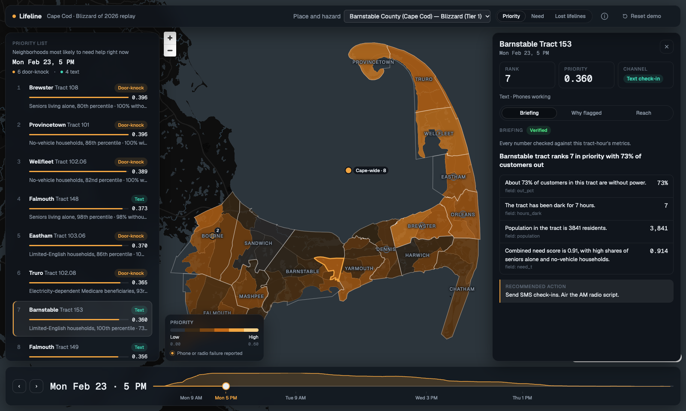

# Lifeline City

**In a disaster, the people in the most danger are often the ones who can't call for help. Lifeline finds them first.**

**Track: Civic Action** · Hackachusetts 2026 · Solo build · All code generated in **Kiro** (Claude Opus 5.5)

[▶ 3-minute demo video](VIDEO_LINK) · [How Kiro was used](docs/kiro-usage.md) · [Run it (no API keys)](#run-it-no-api-keys-needed) · [Methods and assumptions](docs/methods.md)


*Monday Feb 23, noon, replayed from real storm data. Power is going out fast, but phones still work, so all ten top neighborhoods get text check-ins. Falmouth tract 148 ranks first: 90% without power for 4 hours, and in the 98th percentile for seniors living alone. By 6 PM its phones are likely down, and it moves to a door-knock list.*

---

## The problem

On February 22 and 23, 2026, a blizzard hit Massachusetts. Cape Cod took the worst of it:

- **153,000 customers lost power** at the peak, and the entire Outer Cape went dark.
- **Cell and internet service failed** across the Cape. Radio volunteers warned that 6 to 12 more hours of storm could have taken cell service out entirely. The county's 911 dispatch center had a major failure on Thursday.
- **Cape Cod Hospital's emergency room held 120 to 130 patients** instead of the usual 75 to 80. Most were older people whose health slipped while they were isolated at home.

**Every tool the Cape had waited for someone to ask.**
- Shelters help only people who can get there.
- 2-1-1 helps only people who can call.
- Police wellness checks start when a relative phones in.
- The utility's medical list covers only people who filed paperwork. Eversource called 2,246 medical customers across all of Massachusetts; federal HHS emPOWER data counts 2,021 people on electricity-dependent equipment in Barnstable County alone.

A senior who lives alone, with a dead phone and no family nearby, appears in none of these. The county's own after-action review measured who was sheltered, fed and transported. Nothing measured who stayed home and went quiet.

## What Lifeline does

For every neighborhood and every hour of a storm, Lifeline estimates where people are most likely in trouble. It then picks a way to reach them that still works.

| Layer | Question it answers | Built from |
|---|---|---|
| **Need** | Who lives here? | Census ACS 2024 (seniors living alone, disability, limited English, no car, renters) and HHS emPOWER (Medicare patients on electricity-dependent equipment). Covers 56 Cape census tracts. |
| **Lost lifelines** | What have they just lost? | Power out (40%), hours in the dark (30%), phones likely down (20%), urgent downed-wire calls (10%). Covers 15 towns × 119 hours, rebuilt from the utility's own filing with the state. |
| **Reach** | How do we contact them right now? | **Phones working:** a text check-in in English, Portuguese or Spanish. **Phones down:** a door-knock list for police, fire, the Council on Aging, Elder Services and Meals on Wheels. **Everyone:** an AM radio script. |

**Priority = Need × Lost lifelines.** The top 10 neighborhoods are re-ranked every hour.

> **The key rule: when phones are down, silence means nothing.** Most alerting tools treat "no reply" as "probably fine." Lifeline never counts silence in a town whose phones are likely down; it sends people instead. Phones are modeled as down once a town has been at least 80% without power for 8 hours in a row, which is roughly when tower backup batteries run out.

## Who it helps, and how it scales

**Users:** county and town emergency managers, Councils on Aging, and police and fire wellness-check coordinators. These are the people who have to decide at 5 PM on a storm day where to send a limited number of responders.

**Residents it is designed around:** seniors living alone, people on powered medical equipment, households with limited English, people without a car, and renters. These groups are least likely to be on a utility's medical list or to call 2-1-1.

**Accessibility and equity, built in:**
- **Texts work on any phone.** No app, smartphone or data plan is needed. Replies are a digit or a word in the resident's language: 1 or 2, OK / SIM / AJUDA, or OK / SI / AYUDA.
- **Native-language templates.** Portuguese and Spanish templates are written for the Cape's Brazilian and Latino communities, with carbon-monoxide safety first, because CO poisoning follows every long outage.
- **Door-knocks when phones fail, AM radio when everything fails.** The channel follows what still works.
- **Descriptive language only.** A neighborhood is "dark for 40 hours," never "neglected."
- **Aggregates only.** No real individual is ever in the system.

**Why the Cape and not Boston:** Boston has 311 and can see which blocks go quiet. Most of Massachusetts's 351 cities and towns have nothing like it. The Cape is the case study for every town without 311.

**How it scales beyond the hackathon:**
- **Tier 1** (Need + Lost lifelines + Reach) uses only data that already exists for every town in the state. ACS and emPOWER cover the whole country, and Massachusetts utilities already file storm reports with the Department of Public Utilities.
- **New hazards** swap only the lost-lifelines input: flood zones and road closures for floods, power plus heat index for heat waves. The *Place and hazard* selector shows Plymouth, Worcester, Lowell, Springfield and Boston as previews.
- **Tier 2 (Voice)** adds a 311 "who went quiet" signal for cities that publish 311 data. It is designed in the spec; it is not built in this demo.

**What's different:** outage maps show where the power is out. Vulnerability indices show who is at risk. Mass-notification systems send texts. Lifeline joins all three hour by hour, and it decides when a text is pointless.

## See it work (the demo path)

1. **Mon Feb 23, 5 PM.** The list reads "6 door-knock · 4 text." The Outer Cape has been dark long enough that its phones are likely gone.
2. **Open Barnstable tract 153** (rank 7, the Cape's highest share of limited-English households). The briefing is **Verified**: every claim cites a data field, such as `out_pct` 73% or `hours_dark` 7.
3. **Why flagged** shows every component, weight and source behind the score.
4. **Reach → Send check-ins.** Eight simulated households get texts in their own language.
5. **On the phone simulator, household #1 (Português) replies AJUDA.** It is escalated to a simulated Barnstable police wellness check, and the confirmation repeats 911 and 2-1-1. Households that don't reply within 30 seconds land on a human follow-up list.
6. **Step to Mon 6 PM.** Falmouth tract 148 crosses the 8-hour line and flips from **Text** to **Door-knock**, jumping from rank 4 to rank 1. Its door-knock list and AM radio script are ready.
7. **Reset demo.**



*Monday 5 PM: the drawer for Barnstable tract 153. Each claim in the AI briefing names the data field it was checked against.*

**Feature list:**
- An hourly storm replay from Mon 1 AM to Fri 11 PM, with Priority, Need and Lost-lifelines map layers.
- A ranked list with a one-line reason for each neighborhood.
- A *Why flagged* panel for every neighborhood.
- AI briefings with a fact-checker.
- A check-in loop: send texts, replies, escalation, silence after 30 seconds.
- Door-knock lists and radio scripts in three languages.
- Source badges everywhere: Real, Reconstructed, Modeled, Estimated, Simulated.

## How Kiro built it

Full write-up, answering every question in the rules: **[docs/kiro-usage.md](docs/kiro-usage.md)**.

**Strategy:** rules first, then a spec, then code.
- One decisions file is the source of truth.
- Seven steering files restate it for every agent turn.
- One spec turns it into requirements, correctness properties and tasks.
- Kiro generated every line of application code.
- Research and data sourcing (the county's review, the utility's regulatory filing, the hand-entered outage CSVs) were done beforehand with Claude and handed to Kiro as inputs.

| Kiro feature | How it was used | What it changed |
|---|---|---|
| **Steering** (7 files) | product, tech, structure, privacy, outreach style, scoring, design | `scoring.md` copies the formulas word for word, so generated code can tune weights but never change the math. When decisions changed mid-build, Kiro re-synced its own steering and diffed the formula block before writing code. |
| **Spec** (Quick Spec) | 31 requirements, 228 EARS acceptance criteria, 28 correctness properties, 19 tasks with a must-have line and a cut order | During clarification, Kiro caught that one "Cape-wide cellular outage" row would have flagged every town as phones-down all week. That would have turned every text into a door-knock and erased the demo's core contrast. Its answer became Requirement 6. |
| **Task orchestration** | One sub-agent per task, run in waves from the dependency graph in `tasks.meta.json` | A solo build finished everything above the must-have line. |
| **Agent hooks** (4) | Property tests rerun on every `pipeline/*.py` save. A privacy scan runs on every save, every new file, and the end of every agent turn. | The guard caught 10-digit town IDs that looked like phone numbers. Kiro removed them from the exports instead of weakening the guard. |
| **Property-based testing** | Hypothesis in Python and fast-check in TypeScript. Four required properties: scores stay in [0, 1]; the channel always follows the phones-down flag; the verifier accepts exactly the grounded claims; every text fits in 2 SMS segments. | The segment check behind property 4 found that accented Portuguese texts need 3 segments. Text bodies are now accent-free; door scripts and radio keep their accents. The verifier logic rejected **36 of 50** live AI first drafts. |
| **Autopilot + allow-list** | `~/.kiro/settings/permissions.json` lets `uv`, `pytest`, `npm` and `git` run without prompts | `git push`, `reset --hard`, `clean` and `npm publish` still ask first. |
| **Vibe mode** (Default agent) | The visual redesign, guided by a `design.md` steering file against a live dev server | Taste-driven work went faster without more requirements. A zero-height map, caused by a CSS cascade-layer clash, was found from a screenshot and fixed in one prompt. |
| **Kiro CLI** | GitHub sign-in, default model set to Claude Opus 5.5, credit checks with `/usage` | |

**Not used, on purpose:** MCP servers and Powers. All data access is pipeline code, so it is cached, reproducible and testable offline.

**AI with a fact-checker.** The LLM writes only operator briefings, offline, at five key hours. Each claim must cite a real field, and a deterministic verifier checks every number. 49 of 50 briefings passed (14 on the first try, 35 after one retry); the last one fell back to a labeled template. Messages to residents are hand-written templates, never generated.

**Tests:** 294 Python tests (pytest + Hypothesis) and 113 web tests (Vitest + fast-check), all passing.

## Run it (no API keys needed)

The processed data and the cached AI briefings are committed, so the app runs offline.

Requirements: Python 3.13 with [`uv`](https://docs.astral.sh/uv/), Node 25 / npm 11.

```sh
git clone https://github.com/MadhanJ05/lifeline-city && cd lifeline-city
uv venv --python 3.13 && uv pip install -r requirements.txt
.venv/bin/uvicorn api.main:app --host 127.0.0.1 --port 8000     # terminal 1: API
cd web && npm ci && npm run dev                                 # terminal 2: open http://localhost:5173
```

To rebuild everything from raw data:
1. Add `CENSUS_API_KEY` to `.env`, and optionally `ANTHROPIC_API_KEY`.
2. Run `python -m pipeline.run`. Add `--no-llm` to reuse the cached briefings.

## How it works

```
data/raw (public reports, curated CSVs) ──► pipeline/ (Python, run once) ──► data/processed/ ──► api/ (FastAPI) ◄──► web/ (React + MapLibre)
                                                 │
                                    Claude Opus 5.5 briefings + verifier
```

- **`pipeline/`** does the heavy lifting, once:
  - Rebuilds each town's hourly outage curve so it passes through every real report and sums to the Cape total.
  - Scores every tract-hour and writes briefings and message text.
  - Ends with a privacy scan that fails the run on any phone number or street address.
- **`api/`** serves the precomputed files and runs the check-in state machine: simulated texts, seeded replies, escalations, 30-second timeouts and reset.
- **`web/`** is the operator console.

The demo never waits on the internet or the AI.

## Data sources

- **Eversource final event report** for the February 2026 blizzard, filed with the Massachusetts Department of Public Utilities (docket 25-ERP-10). It provides hourly outages and restorations, and 1,720 urgent downed-wire calls by town (1,082 of them on the Cape).
- **Barnstable County Blizzard Hernando after-action review** (July 2026).
- **MEMA** situation report #4 and the MEMA town outage snapshot (Feb 23, 12:30 PM).
- **Census ACS 2024** five-year estimates, **TIGER 2020** tracts and county subdivisions, and **HHS emPOWER** ZIP data.
- **36 town-level outage reports, 20 Cape-wide totals and 14 telecom failures.** These come from Cape Wide News live blogs, police and town posts, WBUR, CBS Boston, Boston.com and the Provincetown Independent. They were hand-entered with a source link on every row (`data/raw/curated/`).

## Privacy and safety

- Real data appears only as tract or town totals. There are no real names, addresses or phone numbers.
- Every household, reply and responder is synthetic and labeled **Simulated**.
- Lifeline does not replace 911. Every message includes 911 and 2-1-1, and every escalation ends with a person.
- A privacy guard blocks any output that contains a phone number or street address, and Kiro hooks run it on every save.
- The API has no authentication and is for local demo use only.

## Limitations and next steps

- **Outage curves:** town curves are **reconstructed** between real reports. Chatham has no town reports, so it is estimated from the Cape-wide share.
- **Phones-down flag:** the flag is **modeled** with the 8-hour rule. The 14 real failure reports appear as map pins.
- **Simulated pieces:** households and replies are simulated. Real texting (Twilio) and Boston Voice are designed in the spec, but not built.
- **Next steps:**
  - A live utility outage feed instead of a replay.
  - Real SMS through Twilio.
  - Boston Voice built from 311 data.
  - A pilot with one Cape town's emergency manager and Council on Aging.

## Repo map

```
.kiro/       steering (7 files), spec (requirements, design, tasks), hooks (4)
config/      scoring weights, languages and help lines, responders, hazards
data/        raw sources and curated CSVs, processed outputs (committed)
pipeline/    offline data pipeline, LLM briefings, verifier, privacy guard
api/         FastAPI app and check-in state machine
web/         React + MapLibre operator console
tests/       294 Python tests (pytest + Hypothesis); web has 113 Vitest + fast-check tests
docs/        kiro-usage.md, methods.md, screenshots
```

## Tests

```sh
pytest -q                                   # pipeline + API
pytest -q -m required_pbt                   # the 4 required property-based tests
cd web && npx vitest --run && npm run build # web logic tests, typecheck and build
```
